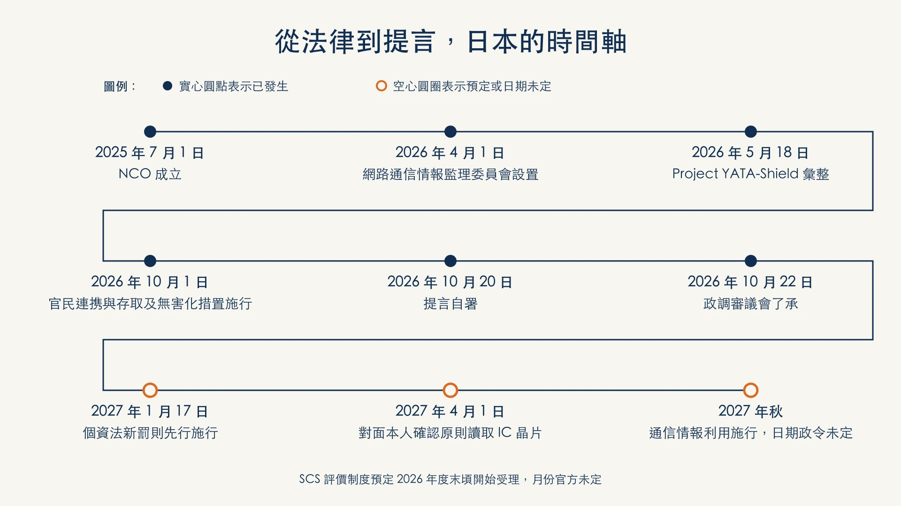
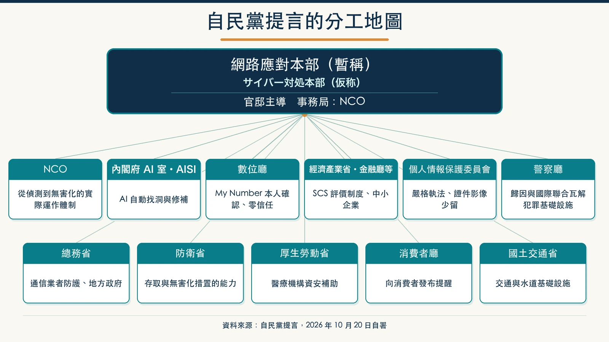
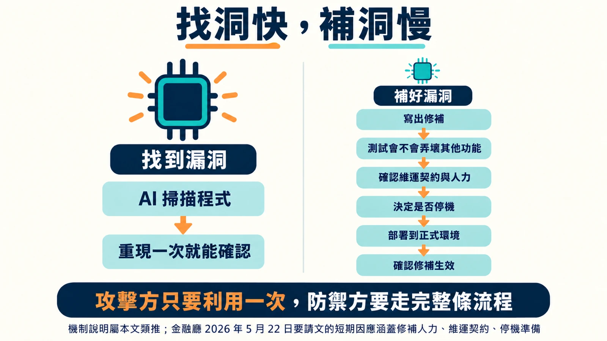
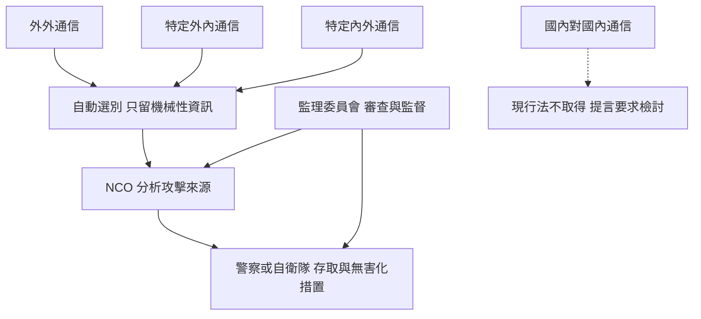
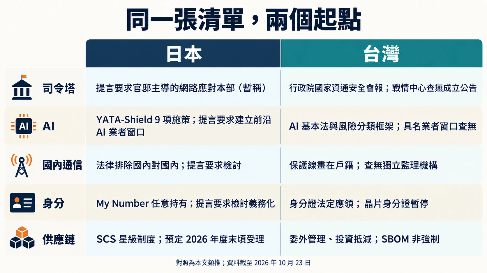

# 日本自民黨「網路有事前夜」提言導讀：AI 飽和攻擊的假想敵、十一個機關的分工，與台灣的對照

2026 年 9 月 25 日早上 9 點 07 分，日本タイムズカー（Times Car）的網站系統偵測到未經授權存取（不正アクセス）。三天後公司發出第 2 報：外洩帳號約 660 萬個，欄位包括姓名、住址、駕照資訊，還有駕照影像這類本人確認文件（[タイムズカー第2報，2026-09-28](https://share.timescar.jp/news/2026/0928/1815.html)）。第 3 報把數字講得更清楚：含身分證件影像的帳號約 160 萬個（[第3報，2026-09-29](https://share.timescar.jp/news/2026/0929/1816.html)）。到了 10 月 16 日的第 4 報，公司改掉了一條沿用多年的規則：原本「會員期間保存、退會後再存 7 年」的證件影像，改成「登錄確認完成後立即刪除」（[第4報，2026-10-16](https://share.timescar.jp/news/2026/1016/1826.html)）。

四天後，日本執政黨自民黨的一份提言在 11 頁裡寫下這一句：在未經授權存取事件中，「因為用駕照影本做本人確認，導致個人資料外洩」（[提言全文（PDF），2026-10-20 自署](https://www.taira-m.jp/%E3%82%B5%E3%82%A4%E3%83%90%E3%83%BC%E3%82%BB%E3%82%AD%E3%83%A5%E3%83%AA%E3%83%86%E3%82%A3%E5%AF%BE%E7%AD%96%E3%81%AE%E6%8A%9C%E6%9C%AC%E7%9A%84%E5%BC%B7%E5%8C%96%E3%81%AB%E9%96%A2%E3%81%99%E3%82%8B%E6%8F%90%E8%A8%80.pdf)）。提言沒有點名是哪一家公司，Times 的案子與這句話的論點吻合，但兩者的對應屬推測。

這份提言的全名是《サイバーセキュリティ対策の抜本的強化に関する提言〜サイバー有事前夜／AIのサイバー飽和攻撃に備えよ！〜》，直譯是「網路安全對策根本強化提言：網路有事前夜，準備迎戰 AI 的網路飽和攻擊」。它把日本眼前的處境定義成「サイバー有事前夜」，也就是網路危機爆發前一晚。外洩件數的說法並不一致：民間彙整的公開事案是近五年最多，個人情報保護委員會的年度報告件數卻比前一年度少（見主線四）。提言本身沒有說明依據哪一種統計。

處方倒是很具體。核心是要求政府由首相官邸主導，設一個新的「網路應對本部（暫稱）」。另外替十一個政府機關各開一份待辦。份量最重的一句放在結尾：要政府「不惜」檢討利用國內通信資訊。

台灣讀者讀這份文件，會一再碰到自己也還沒解完的題目，例如證件影像該留多久、政府能不能看通信。兩邊法律走到的位置不同，對照起來反而看得清楚。

提言全文的繁體中文翻譯（中日對照）見 [提言全文繁體中文翻譯](translation/)；那是 AI 翻譯，未經人工審核，以日文原文為準。

**先看結論**

- 這是自民黨的正式提言，10 月 22 日在黨內通過，不是法律，也不是政府的決定；截至 10 月 23 日，查無已交給首相或官邸的紀錄。
- 五條主線：由官邸主導設網路應對本部（暫稱），並強化國家網路統括室（NCO）在重大事件時跨部會統括的機制；與前沿 AI 業者合作，以 AI 自動修補漏洞為目標。另要推動 My Number 卡做本人確認並「檢討」取得義務化、以預定中的 SCS 評價制度與供應鏈觀測網拉高中小企業防護，並在結語要求檢討利用國內通信資訊。
- 全文最重的一句在結語：提言要求：若強化法規定的利用外國關聯通信資訊仍不足以應對，政府要「不惜」檢討把國內通信情報用於防止被害（原文「国内通信情報を被害の防止のために利用すること」）；結構上仍是要求檢討，不是決定。
- 日本現行法的通信情報利用不含國內對國內通信，而且預定 2027 年秋才施行，提言在施行前就要求檢討往國內延伸。
- 台灣對照（本文類推）：台灣已有針對特定對象的情報監察，保護線畫在「受監察人有沒有戶籍」；查無日本式的不分對象大量取得、自動選別，也查無對應的獨立監理機構與主動式網路防禦（ACD）專法。

## 這份文件是什麼，不是什麼

這是政黨內部的正式提言，不是法律，也不是內閣的決定。提出者是自民黨「国家サイバーセキュリティ戦略本部」（國家網路安全戰略本部），本部長是眾議員平將明。提言自署的單位是「自由民主党政務調査会」，標題欄寫的是「国家サイバーセキュリティ戦略本部　提言」。自民黨官網 10 月 21 日發布的報導稿則把同一個本部寫成「対策本部」（[自民黨官網，2026-10-21](https://www.jimin.jp/news/information/214417.html)），黨網站自己前後用字不一。本文用提言自署的「戦略本部」。

| 日期 | 事件 | 來源 |
|---|---|---|
| 2026-10-09 | 本部聽取國家網路統括室（国家サイバー統括室，NCO；2025-07-01 由 NISC 改組而成）說明；NCO 表示一連串事件的關聯與 AI 濫用「尚不明確」 | [自民黨官網](https://www.jimin.jp/news/information/214364.html)（單一彙整來源） |
| 2026-10-20 | 本部彙整提言，文件自署日期 | [提言全文（PDF）](https://www.taira-m.jp/%E3%82%B5%E3%82%A4%E3%83%90%E3%83%BC%E3%82%BB%E3%82%AD%E3%83%A5%E3%83%AA%E3%83%86%E3%82%A3%E5%AF%BE%E7%AD%96%E3%81%AE%E6%8A%9C%E6%9C%AC%E7%9A%84%E5%BC%B7%E5%8C%96%E3%81%AB%E9%96%A2%E3%81%99%E3%82%8B%E6%8F%90%E8%A8%80.pdf) |
| 2026-10-21 | 自民黨官網公告提言彙整 | [自民黨官網](https://www.jimin.jp/news/information/214417.html) |
| 2026-10-22 | 政調審議會了承（通過），成為黨的正式提言 | [平將明官網](https://www.taira-m.jp/2026/10/post-372.html) |
| 截至 2026-10-23 | 是否已交給首相或官邸：查無 | 報導只稱「近く」（二手，[日テレNEWS 經 Yahoo 轉載](https://news.yahoo.co.jp/articles/a9e7a56aacd2e4a40fa80ccf83ef3d2a6db0c12b)） |

所以，文件「已經是自民黨的正式立場」，但「政府要不要照做」還沒有答案。提言裡大量的「〜すること」是黨對政府的要求，其中又有不少只是「検討すること」（要求檢討）。讀到後面 My Number 卡（マイナンバーカード）義務化、國內通信資訊這兩段時，這個差別很要緊。

還有一份容易混淆的前作。同一個本部在 2026 年 5 月 14 日提出過另一份提言，當天交給高市早苗首相（[平將明官網，2026-05-14](https://www.taira-m.jp/2026/05/post-370.html)）。兩份文件在官方文字上互不引用，本文只談 10 月這一份。

至於各界怎麼看：截至 2026-10-23，查無具名專家或報紙社論針對這份提言的評論。本文不替它補一個「各界反應」。

## 一張表看完十一個機關的待辦

提言分三層。第一層是前言的危機判斷；第二層是對政府整體的基本要求：以官邸主導成立「網路應對本部（暫稱）」（サイバー対処本部（仮称）），事務局設在 NCO，重大損害發生時適時召開本部會議；另外要加速自衛隊與警察的能力建構、推動經營層意識改革，並新設能給出市場行情待遇的人事與薪給制度（引進職務型僱用等），打破僵化的公務員制度。第三層是對個別機關的要求，提言編成（1）到（11）共十一項；其中第（4）項是「經濟產業省及金融廳等」合寫，下表照原文編排，一項一列。

| 機關 | 提言要求的核心動作 |
|---|---|
| （1）國家網路統括室（NCO） | 讓從威脅偵測到「無害化」的實際運作體制有效運轉；與五眼聯盟等交換歸因情資；強化 GSOC（政府關係機關資訊安全橫向監視與即應調整小組，負責監看政府機關等並應變事件）的監控；強化重大事件時由 NCO 橫向統括各省廳、指揮初動的法律與實務機制；推動 Project YATA-Shield；與 OpenAI、Google、Anthropic 建直接窗口；政府採購的資安可視性；PQC 移轉訂早期期限 |
| （2）內閣府 AI 室／AISI（AI セーフティ・インスティテュート，AI 安全研究所） | 早期改訂《AIインシデントレスポンス・アプローチブック》；推動 YATA-Shield；與各國 AISI 及前沿 AI（frontier AI，台灣金管會稱「前沿 AI 模型」）業者合作，目標是 AI 不只做漏洞診斷，也能自動、自律地修補 |
| （3）數位廳（デジタル庁） | 零信任；政府雲（ガバメントクラウド）嚴格稽核；推動以 My Number 卡做本人確認，並「檢討」取得義務化；對卡片與相關系統做專家參與的全面清查；驗證 DID／VC（分散式身分與可驗證憑證，提言稱為抗竄改的 web3 時代信任基礎）的有用性 |
| （4）經濟產業省及金融廳等 | 上市公司資安揭露，促進設置 CISO；要求遵循經營指引；搭配 SCS 評價制度推動；擴充「サイバーセキュリティお助け隊サービス」（政府補助的中小企業資安服務）；建立供應鏈觀測網；AI 滲透測試；檢討國產 OT 資安 AI；檢討 AI Agent 指引；與民間團體一起「檢討」讓外洩受害者向信用情報機關「一站式通報」的機制；金融業落實 5/22 要請文；擴充 JC-STAR（日本為 IoT 產品做資安認證的制度） |
| （5）個人情報保護委員會 | 對初動報告延遲或低估事態的企業，迅速要求報告、實施進場檢查，並毫不猶豫地勸告與命令；訂定證件影像等資料保存期間與保存方式的基本規則；宣導新設罰則；建立不會被釣魚利用的外洩通知方式 |
| （6）警察廳 | 擴充「サイバー特別捜査部」；建立公開歸因的證據保全基礎；主導國際共同 takedown 與加密資產追蹤；把 TTPs（攻擊者的戰術、技術與程序）回饋民間；防範二次受害 |
| （7）總務省 | 通信業者積極防護；強化 NICT（情報通信研究機構，從事資訊通信研發，提言要它提升攻擊分析能力）；防止一般設備被當跳板；要求地方政府掌握所有網站系統，並檢討必要時暫停服務；加速東京、名古屋、大阪之間的 QKD（量子金鑰分發，提言定位為後量子密碼之外的第二層防護）網路 |
| （8）防衛省 | 強化含「アクセス・無害化措置」在內的主動式網路防禦（ACD）能力；強化既有的威脅獵捕能力，並整備防護重要基礎設施等系統所需的能力 |
| （9）厚生勞動省 | 補助醫療機構資安經費、陪伴式輔導；活用外部專家；對特定機能病院做資安點檢 |
| （10）消費者廳 | 彙整消費諮詢情資、向消費者發布提醒 |
| （11）國土交通省 | 航空、機場、港灣、鐵道、水道、物流的攻擊面管理（ASM）、事件發生時到場協助、諮詢窗口 |

## 主線一：司令塔與指揮權，無害化措置已施行，通信情報利用預定 2027 年秋

日本現在的網路安全指揮鏈，主軸是 NCO。NCO 在 2025 年 7 月 1 日由舊的 NISC（內閣網路安全中心，内閣サイバーセキュリティセンター）改組而成（[NCO 沿革](https://www.cyber.go.jp/about/history/index.html)、[e-Gov 修正履歷](https://laws.e-gov.go.jp/law/507AC0000000042)）。提言要再往上疊一層：官邸主導的網路應對本部（暫稱），NCO 當事務局。另外它要求強化一套「法律與實務上的機制」，讓 NCO 在重大事件時「橫向統括各省廳的權限」、站上第一線指揮初動與防止擴大。這是要求強化，不代表 NCO 現在已有這樣的權限。

提言前言自己也要求政府「縦割りを排し」（打破各省廳本位主義）。資安事件一來，金融歸金融廳、通信歸總務省、醫療歸厚勞省，各有各的主管法。提言用的詞是「強化」既有機制，沒有說要修哪一條法、給 NCO 什麼新權限。這一點要看政府後續怎麼接。

更有意思的是法律施行的順序。支撐日本主動式網路防禦的是《重要電子計算機に対する不正な行為による被害の防止に関する法律》，通稱「サイバー対処能力強化法」（網路應對能力強化法），令和 7 年法律第 42 號，2025 年 5 月 23 日公布（[e-Gov 法令](https://laws.e-gov.go.jp/law/507AC0000000042)）。它分批施行，而且最常被混在一起講的兩件事，施行日其實差了一年。

| 日期 | 生效內容 | 來源 |
|---|---|---|
| 2025-05-23 | 強化法公布 | [e-Gov](https://laws.e-gov.go.jp/law/507AC0000000042) |
| 2025-07-01 | NISC 改組為 NCO | [NCO 沿革](https://www.cyber.go.jp/about/history/index.html)、[e-Gov 修正履歷](https://laws.e-gov.go.jp/law/507AC0000000042) |
| 2026-04-01 | 網路通信情報監理委員會（サイバー通信情報監理委員会）設置，委員 5 名 | [監理委員會官網](https://www.aoc.go.jp/about/) |
| 2026-10-01 | 公私協力（官民連携：協議會、資產申報、事件報告）與存取與無害化措置（アクセス・無害化措置）施行 | [內閣官房施行說明，2026-09](https://www.cao.go.jp/cybersecurity/pdf/sekousetsumei.pdf)、[政令第46號](https://www.cao.go.jp/cybersecurity/pdf/sekoukijitsu.pdf) |
| 2027 年秋（預定） | 「通信情報の利用」（強化法第 3～7 章）施行；政令未定 | [內閣官房施行說明](https://www.cao.go.jp/cybersecurity/pdf/sekousetsumei.pdf) |
| 2027-11-22 | 通信情報利用的法定施行上限 | [e-Gov](https://laws.e-gov.go.jp/law/507AC0000000042) |

「アクセス・無害化措置」（存取與無害化措置）指的是對確認的攻擊伺服器主動存取、必要時讓它失去作用。這項措置在法律上已於 2026 年 10 月 1 日施行。用來找出攻擊伺服器的另一半，也就是從通信資訊中偵測攻擊來源的通信情報利用，預定 2027 年秋天施行，確切日期還沒有政令定出。

兩項制度的施行時間錯開了約一年。這段期間無害化的目標，可能要仰賴公私協力協議會裡業者的事件報告、盟國分享的情資、警察偵查的成果等來源（本文類推）。提言在這個空窗期提出，要求 NCO 讓從偵測到無害化的實際運作體制「有效運轉」，並把通信情報利用寫成「著實施行」。這項要求落在偵測端尚未施行的期間，可以讀成對進度的催促，但提言原文沒有這樣說（本文類推）。

這一段還有一個容易被略過的角色：警察廳。提言要它擴充「サイバー特別捜査部」（網路特別搜查部），對國家背景的攻擊建立「公開歸因」（パブリック・アトリビューション）所需的證據保全。也要它主導國際共同行動，瓦解犯罪者使用的 C2 伺服器，並追蹤遭竊的加密資產。提言在這裡直接把 takedown 括註為「無害化」（テイクダウン（無害化））。防衛省那一節的 ACD 能力，針對的是對國家與基幹基礎設施等的重大網路攻擊；警察的 takedown 走的是刑事偵查與國際執法合作。兩條路都通向「讓攻擊者的基礎設施失效」，法源與門檻不同，提言沒有處理兩者怎麼分工。

## 主線二：AI 防禦與 YATA-Shield，找洞容易，補洞難

### 「Mythos 問題」是提言使用的稱呼，政府文件查無

提言兩次提到「いわゆる『Mythos 問題』」（所謂的 Mythos 問題），指的是「次世代 AI 模型被濫用，使網路攻擊更自律、更高度化的風險」。這個詞要小心用。

Claude Mythos Preview 是 Anthropic 在 2026 年 4 月 7 日公布的模型，官方表明不打算一般開放，只提供給合作夥伴，用於找出並修補關鍵軟體的漏洞（[Anthropic Project Glasswing](https://www.anthropic.com/glasswing)）。頁面上關於它發現多少高嚴重度漏洞的數字，是公司自己的說法。

「Mythos 問題」這四個字，在日本政府的文件裡查無，只出現在這份提言，而且提言自己加了「いわゆる」。這個稱呼是否為黨自創，無從判斷；可以確定的是，政府文件沒有定義過這個術語。

政府的正式文件是 2026 年 5 月 18 日 NCO 等 14 個府省廳與機關彙整的《AI 性能の高度化を踏まえたサイバーセキュリティ対策の強化について〜Project YATA-Shield〜》（[YATA-Shield 本文](https://www.cyber.go.jp/pdf/press/20260518_AI_CS_Package.pdf)）。它的背景段落寫的是「本年 4 月 7 日に米国 Anthropic 社が公表した Claude Mythos Preview」等前沿 AI 模型，讓漏洞發現與修正等資安能力快速提升，必須「帶著危機感迅速因應」。YATA 是「Yielding Advanced Threat Awareness with AI」的縮寫，取日本神話中「如實映照」的八咫鏡意象（[YATA-Shield 概要版](https://www.cyber.go.jp/pdf/press/20260518_AI_CS_gaiyou.pdf)）。

| 欄位 | 內容 | 來源 |
|---|---|---|
| 公布日 | 2026-05-18 | [YATA-Shield 本文](https://www.cyber.go.jp/pdf/press/20260518_AI_CS_Package.pdf) |
| 參與機關 | 14 個府省廳與機關 | 同上 |
| 施策 | 9 項＝重要基礎設施與政府機關 4 項＋漏洞因應 5 項 | 同上 |
| 背景 | Anthropic 2026-04-07 公布的 Claude Mythos Preview 等前沿 AI 模型 | 同上 |
| 縮寫 | Yielding Advanced Threat Awareness with AI，取八咫鏡意象 | [概要版](https://www.cyber.go.jp/pdf/press/20260518_AI_CS_gaiyou.pdf) |

所以正確的說法是：日本政府把 Mythos Preview 當成前沿 AI 能力躍升的代表，以此為背景推出 YATA-Shield；自民黨提言把這類風險簡稱為「Mythos 問題」。

### 金融業先被要求一個月內動起來

YATA-Shield 公布四天後，金融廳與日本銀行在 2026 年 5 月 22 日聯名發函要求（「要請文」，金総政第 3245 號等），要求金融機構在經營高層直接參與下，「大約一個月內」落實 9 項短期因應（[金融廳要請文](https://www.fsa.go.jp/news/r7/sonota/20260522-5/01.pdf)）。提言裡金融那一條，就是要金融廳持續推動這份「要請文（5 月 22 日）」。

9 項的標題讀起來很像一張修補作業的盤點表：把前沿 AI 因應當經營課題、找出優先系統、清掉技術債、增加修補人力、確認與廠商的維運契約、修補流程改為風險導向、強化修補以外的對策、預備優先系統停機、維持外部合作。要請文自己也寫明，這只是「應急的因應」，中長期必須轉向「漏洞因應的自動化」。

要請文同時引用英國 AISI 對 Mythos Preview 的評估：以現階段來說，前沿 AI 對防護充分的 IT 系統，還不能說能達成攻擊。結論是回頭把既有指引裡的基本功做扎實。

### 為什麼找洞比補洞先到

提言對 AI 室／AISI 的要求裡有一句野心很大的話：與前沿 AI 業者合作，不只讓 AI Agent 做漏洞診斷，還要做到「AI 修補漏洞（打上修補程式）的自動化、自律化」。

這兩件事的難度不在同一個量級（本文類推）。找到一個漏洞，可以用一次重現來驗證：輸入某段資料，程式當掉或吐出不該吐的東西，結果是對是錯一目了然。修補則要回答更多問題：改了這行，其他功能會不會壞？要不要停機？誰有權限部署到正式環境？廠商合約有沒有涵蓋夜間與假日？金融廳的 9 項裡，有好幾項其實都在處理這些「修補以外」的瓶頸：人力、契約、停機判斷。

AI 找洞的速度，攻擊方和防禦方都拿得到，但用法不對等：攻擊方用一次就算贏，防禦方還得排測試、改版、部署。如果找洞的速度真的被拉高，修補流程的時間差就可能拉長風險暴露的期間（本文類推）；不過前面金融廳要請文引用的英國 AISI 評估也說，前沿 AI 對防護充分的 IT 系統還不能說能達成攻擊，這個風險何時成真仍有變數。提言把「AI 自動修補」寫成目標，方向沒錯，但它要求的是「目指すこと」（以此為目標），沒有時程。

提言另要經濟產業省「檢討」企業安全使用 AI Agent 的指引，理由是 AI Agent 可能有「意圖之外的行為」。這和找洞補洞是同一件事的另一面：當防禦方也把 Agent 放進自己的環境，Agent 本身就成為需要權限控管的對象。

### 「中國製 AI」那一句

提言前言有一句：「最近の攻撃は、中国製の AI モデルが使われているという報道もある」（最近的攻擊，也有報導指出使用了中國製的 AI 模型）。提言沒有說明是哪一則報導。

時間上相近的，是 GMO サイバーセキュリティ byイエラエ在 2026 年 10 月 19 日揭露，在攻擊基礎設施上發現 AI 自律型滲透測試系統「ARTEX」。NHK 10 月 20 日的報導導言用了「中国系の AI」一詞（二手，[NHK，2026-10-20](https://news.web.nhk/newsweb/na/nd-20261020de61888)），ScanNetSecurity 的報導則沒有做國別歸因（二手，[ScanNetSecurity，2026-10-21](https://scan.netsecurity.ne.jp/article/2026/10/21/56522.html)）。提言所指是否就是這起事件，屬推測。和這句話放在一起讀的，是 NCO 在 10 月 9 日對自民黨的說明：一連串事件之間的關聯與 AI 濫用「目前尚不明確」（[自民黨官網，2026-10-09 會議](https://www.jimin.jp/news/information/214364.html)，單一彙整來源）。10 月 9 日 NCO 向黨本部說明時，仍表示一連事案的關聯與 AI 濫用「尚不明確」；在那之後政府有沒有更新說法，查無資料（本文類推）。

### 跟美國業者直接搭線

提言在 NCO 與 AI 室兩處，都要求與 OpenAI、Google、Anthropic 等美國前沿 AI 業者建立「直接的合作窗口」，用 AI 檢查政府資訊系統、加速漏洞診斷與排序。日本 AISI（AI セーフティ・インスティテュート）在 2026 年 1 月 9 日已發布《AIインシデントレスポンス・アプローチブック》v1.0（[AISI，2026-01-09](https://aisi.go.jp/activity/activity_security/260109/)），提言要它早期改訂；改訂版是否已發布，查無。

PQC 也在這條線上。提言說歐美主要國家預計在 2030／2031 年前後把影響大的系統遷移到後量子密碼，要求日本政府對優先系統「訂出早期期限」。它沒有自己給年份。

## 主線三：身分確認，從影本到晶片

回到開頭 Times 的駕照影像。

日本的金融業與電信業在 2027 年 4 月 1 日有一個硬期限。《犯罪收益移轉防止法》（犯罪収益移転防止法）施行規則修正後，面對面確認身分原則上必須讀取證件的 IC 晶片，非面對面的「傳送證件影像」方式同時廢止。金融廳 10 月 9 日的提醒直接寫到：自令和 9 年 4 月 1 日起，接受本人確認文件影像傳送的方式廢止，原則上統一為 IC 晶片資訊的讀取，並要求業者「不要等到施行日」（[金融廳，2026-10-09](https://www.fsa.go.jp/news/r8/sonota/20261009/20261009.html)）。

這裡有個提言自己沒講清楚的細節：讀晶片的對象不限 My Number 卡，附晶片的在留卡、護照等也算。提言寫的是「マイナンバーカード等」，那個「等」字很重要。

提言對數位廳的要求分了好幾層：

| 層次 | 提言用語 | 性質 |
|---|---|---|
| 推動 My Number 卡在民間的本人確認利用 | 加速、推進 | 推動 |
| 強化業者諮詢窗口 | 強化體制 | 推動 |
| My Number 卡取得義務化 | 「義務付けを検討すること」 | 要求檢討 |
| 卡片與相關系統的安全 | 含專家驗證的全面清查 | 要求執行 |
| DID／VC | 驗證有用性 | 要求驗證 |

取得義務化是爭議最大的一項。日本 My Number 卡目前是任意申請，2026 年 4 月底的保有率約 83%（二手，[日本經濟新聞，2026-05-19](https://www.nikkei.com/article/DGXZQOUA197K00Z10C26A5000000/)）。政府 2026 年 7 月 21 日的「數位社會實現重點計畫」並未納入取得義務化（二手，[共同通信經愛媛新聞，2026-07-21](https://www.ehime-np.co.jp/article/ky202607150346300022)）。提言在三個月後重新要求「檢討」，並附上一串條件：擴充服務、推動手機搭載生物辨識、支援不熟悉數位的人、加強宣導，以及做一次全面清查。政府目前沒有決定要做。

另一端是日本的個人情報保護委員會。提言要它對必要的業種、與主管省廳一起，針對「為本人確認而取得的影像等」訂出保存期間與保存方式的基本規則，讓企業不要「無謂地保有」不需要的個人資料。這與 Times 第 4 報的做法方向一致：證件看完就刪，被偷的東西就少一點。

罰則也已經到位一部分。日本個資法修正（令和 8 年法律第 56 號）2026 年 7 月 10 日成立、7 月 17 日公布，新設第 180 條：以未經授權存取等方式取得個人資料者，處 2 年以下拘禁刑或 100 萬日圓以下罰金，這部分在 2027 年 1 月 17 日先行施行（[個人情報保護委員會改正專頁](https://www.ppc.go.jp/personalinfo/legal/r8kaiseihogohou)、[法律原文 PDF](https://www.ppc.go.jp/files/pdf/260717_houritsu.pdf)）。提言要的是把這條罰則「有效宣導」出去。

還有一個很實際的小題目：外洩之後怎麼通知受害者。提言在 NCO 與日本個人情報保護委員會兩處都寫了同一件事，擔心「通知受害者」本身變成網路釣魚的溫床。攻擊者只要模仿外洩通知信，就能對已經緊張的受害者再騙一次。這條沒有給答案，只要求技術面一起研究出安全的聯絡方式。

## 主線四：供應鏈與中小企業，替廠商分級、替小公司共同監控

提言前言有一段點出它真正擔心的對象：法律上被要求高度因應的重要基礎設施業者之外，還有大量持有個資的企業正遭到廣泛的未經授權存取，這些企業的因應水準必須拉高。下表是幾家公司自己公告的數字。

| 事件 | 公司公告的數字 | 來源 |
|---|---|---|
| ふるさとチョイス（2026-10-17 遭入侵） | 4,454,097 件 | [トラストバンク，2026-10-20](https://www.trustbank.co.jp/newsroom/newsrelease/news261020/) |
| タイムズカー | 外洩帳號約 660 萬；含身分證件影像約 160 萬 | [第2報](https://share.timescar.jp/news/2026/0928/1815.html)、[第3報](https://share.timescar.jp/news/2026/0929/1816.html) |
| KDDI（ISP 郵件系統，最早 2026-05-16 遭入侵） | 郵件地址 12,231,954 名，其中密碼 7,616,173 名 | [KDDI 續報](https://newsroom.kddi.com/news/assets/2026/kddi_nr_s-73_4619/kddi_nr_s-73_4619_pdf_01.pdf) |

至於「外洩越來越多」這個判斷，官方與民間的數字並不一致：

| 統計 | 數字 | 來源 |
|---|---|---|
| 警察廳：2026 上半期勒索軟體被害 | 123 件，半期統計最多 | [警察廳，2026-09](https://www.npa.go.jp/publications/statistics/cybersecurity/data/R8kami/R08_kami_cyber_jousei.pdf) |
| MM 総研（民間）：網路攻擊造成的資訊外洩公開事案 | 1–9 月 454 件（年增 49%）；10/13 累計 485 件 | 二手，[nippon.com，2026-10-18](https://www.nippon.com/ja/japan-data/h02929/) |
| 個人情報保護委員會令和 7 年度報告：民間事業者外洩等 | 17,139 件，較前一年度減約一成 | 二手，[熊本日日新聞轉載共同通信](https://www.kumanichi.com/articles/2010806) |
| 古川數位大臣 2026-10-02 記者會 | 不正目的外洩「未必呈增加趨勢」 | 二手，[ScanNetSecurity，2026-10-08](https://scan.netsecurity.ne.jp/article/2026/10/08/56413.html) |

民間彙整的公開事案是近五年最多，官方的年度報告件數卻是下降的。兩者口徑不同，一個數的是企業公開宣布的攻擊事案，一個數的是向主管機關報告的所有外洩（包含誤寄、誤交付）。提言用「相次ぐ」（接連發生）描述這些事件，但沒有交代依據哪一種統計；上表把兩種統計並列，供讀者比較。

### SCS 評價制度：何時開始受理，提言與官方寫法不同

提言要求經濟產業省把「SCS 評価制度」（サプライチェーン強化に向けたセキュリティ対策評価制度，供應鏈強化安全對策評價制度）推薦給大企業，當成管理委外對象的方法，並寫明「令和 9 年 3 月運用開始予定」。

經產省與 IPA 的官方說法比較保守：★3、★4 兩個等級預定在「2026 年度末頃」開始受理申請，★5 還在檢討中（[經濟產業省 SCS 頁面，2026-03-27](https://www.meti.go.jp/policy/netsecurity/scs.html)、[IPA SCS 頁面](https://www.ipa.go.jp/security/scs/index.html)）。日本的 2026 年度末就是 2027 年 3 月前後，所以兩者不衝突；但「令和 9 年 3 月」這個月份是提言的寫法，官方頁面沒有寫到月份。兩者都是預定。

SCS 讓發包方可以用星級要求承包方。提言另外要的「サプライチェーン観測網」（供應鏈觀測網），是讓供應鏈上的企業加入一張共同監控網，由系統替人手不足的中小企業做 24 小時監控，在一家被打的時候阻止攻擊擴散到其他參與企業。SCS 看的是廠商平時做到哪，觀測網看的是出事當下有沒有人盯著（本文類推）。

中小企業端，提言要大幅擴充「お助け隊」服務的補助範圍，並在服務中提供 AI 資安功能；人才端，要充實「情報処理安全確保支援士」（日本的國家登錄制資安資格），並媒合他們與中小企業。

### 上市公司設 CISO：提言的要求，不是公司治理守則的規定

提言要經濟產業省與金融廳等促進上市公司設置 CISO，並舉出「設置身為經營陣一角、有實權的 CISO」來強化資安風險因應的案例加以推廣。這容易被誤讀成日本公司治理守則的規定。2026 年 7 月 21 日公布的公司治理守則改訂版，網路安全只出現在原則 4-4 的解釋指針，而解釋指針不適用「遵循或解釋」（comply or explain）；全文也沒有 CISO 字樣（[金融廳，2026-07-21](https://www.fsa.go.jp/news/r7/singi/20260721.html)）。促進設置 CISO 是提言自己的要求。

## 主線五：國內通信資訊，結語要求「不惜」檢討利用

提言的結語只有一段。前半要政府對每一項建議「立即」著手預算與必要法令的檢討；後半是這一句：

> 鑑於現在及今後重大損害的發生，在サイバー対処能力強化法下利用「外国関連通信情報」仍不足的情況下，要求政府對「為防止損害而利用国内通信情報」等事項，「不惜」進行檢討。（原文：検討を行うことも辞さずに対応することを求める）

這句話的力道在「辞さず」（不惜）兩個字，結構上仍是「要求檢討」。

要理解它跨過了哪條線，得先看強化法本身怎麼畫線。強化法的通信情報利用（2027 年秋施行預定）涵蓋三類通信：外國對外國但經過日本的「外外通信」、特定的外國對國內、特定的國內對外國。國內對國內的通信不在取得範圍內。法條明文要求尊重「通信の秘密」（通信秘密），取得後必須先經過「自動選別」，只留下 IP 位址、指令這類機械性資訊，選別完成前任何人都不能看。另外還設了獨立的網路通信情報監理委員會，2026 年 4 月 1 日成立，委員長是前札幌高等法院長官近藤宏子，共 5 名委員。依官網列出的所掌事務，委員會除了審查通信情報的取得與利用，也負責審查及承認警察或自衛隊實施存取與無害化措置（[監理委員會官網](https://www.aoc.go.jp/about/)）。

還有一個用詞細節。「外国関連通信情報」與「国内通信情報」都不是法條用語；強化法的章名用的是「外外通信目的送信措置」「特定外内通信目的送信措置」等。這兩個詞是提言自己的說法。

法律刻意不碰國內對國內的通信，用自動選別和獨立監理委員會來回應通信秘密的疑慮；提言則在這套機制還沒施行之前，就要求政府準備好往界線另一邊多走一步的選項。

從攻防的角度看，這個要求有它的工程理由（本文類推）：如果攻擊者把跳板放在日本國內被入侵的一般設備上（提言在總務省一節也特別提到「機器の踏み台化」），通信兩端都在國內，外外、外內通信的偵測就看不到。但偵測面擴大之後，治理面的監督是否跟著擴大、自動選別能否同樣適用，提言都沒有寫。

## 台灣現況對照

以下依同樣五條主線，把台灣官方與民間的現況放在一起。除非另標日期，各項現況的資料截至 2026-10-23；法規與公告的公布日期見文末來源清單；標「查無」的，指截至該日在官方材料中未見。

### 一、司令塔與指揮權

| 面向 | 台灣現況 | 來源與日期 |
|---|---|---|
| 統籌機制 | 行政院定期召開國家資通安全會報，院長或副院長為召集人（資安法第 5 條） | [資通安全管理法，2025-09-24 修正公布](https://law.moj.gov.tw/LawClass/LawAll.aspx?pcode=A0030297) |
| 會報設置辦法 | 2026-03-02 發布；協同副召集人由國安會諮詢委員兼任 | [資安署](https://moda.gov.tw/ACS/nicst/establishment/660) |
| 主管機關 | 數位發展部資通安全署，與數發部同日 2022-08-27 成立 | [資安署組織法沿革](https://law.moj.gov.tw/LawClass/LawHistory.aspx?pcode=K0000201) |
| 戰情中心 | 《國家資通安全戰略 2025》建議新設「國家資安戰情協同應變中心」；截至 2026 年 10 月，查無成立公告 | [國家資通安全戰略 2025，2025-04](https://www.president.gov.tw/File/Doc/9d056651-e4a0-4d51-adeb-5fee5ee71299) |
| 重大事件調度 | 主管機關得調度各級機關資安人員支援（第 18 條第 2 項），限公務機關人員 | [資通安全管理法](https://law.moj.gov.tw/LawClass/LawAll.aspx?pcode=A0030297) |
| 重大事件調查 | 中央目的事業主管機關得調查特定非公務機關重大事件（第 25 條） | 同上 |
| 通報時限 | 知悉後 1 小時內通報 | [資通安全事件通報應變及演練辦法，2026-01-05 修正](https://law.moj.gov.tw/LawClass/LawAll.aspx?pcode=A0030305) |
| 未通報罰則 | 特定非公務機關 30 萬至 1,000 萬元（第 29 條） | [資通安全管理法](https://law.moj.gov.tw/LawClass/LawAll.aspx?pcode=A0030297) |
| 主動防禦分工 | 軍事部門主動防禦由國防部主責；情報部門由國安局；調查局與刑事局負責鑑識、溯源與執法 | [國家資通安全戰略 2025](https://www.president.gov.tw/File/Doc/9d056651-e4a0-4d51-adeb-5fee5ee71299) |
| 偵查單位 | 刑事局科技犯罪防制中心與偵查第九大隊並存；與日本「サイバー特別捜査部」僅功能類比 | [刑事警察局辦事細則，2025-11-05 修正](https://law.moj.gov.tw/LawClass/LawAll.aspx?pcode=D0010042) |

台灣在法律上已經有一個統籌會議：國家資通安全會報在 2025 年修法時寫進資安法第 5 條。它的層級是行政院；日本提言要求設置的那種官邸主導、重大事件時召開的網路應對本部（暫稱），台灣在本次查核的官方材料中查無對應的已設機構。戰略文件提出的戰情協同應變中心是最接近的構想，截至 2026 年 10 月，查無成立公告。

指揮權的差別更細。日本提言要求強化讓 NCO「橫向統括各省廳權限」的機制；台灣資安法第 18 條第 2 項給主管機關的是「調度人員」，而且只及於公務機關的資安人員，民間企業不在內。它能調派的是人手，碰不到其他部會的決策權（本文類推）。

民間側，TWCERT/CC 自 2024 年 1 月起由國家資通安全研究院營運（[TWCERT/CC 沿革](https://www.twcert.org.tw/tw/cp-24-72-b31f4-1.html)），資安署長稱它是民間企業資安事件通報與協處的窗口（二手，[CIO Taiwan 專訪，2025-10-03](https://www.cio.com.tw/?p=99072)）。

### 二、AI 防禦

| 面向 | 台灣現況 | 來源與日期 |
|---|---|---|
| AI 法制 | 《人工智慧基本法》2026-01-14 公布施行，20 條，國科會為中央主管機關，無罰則 | [全國法規資料庫](https://law.moj.gov.tw/LawClass/LawAll.aspx?pcode=H0160093) |
| 風險分類 | 數發部《人工智慧風險分類框架 v1.0》2026-07-07 發布，列有「用於網路攻擊」「AI 自主代理之授權外行為」等風險類型 | [數發部 PDF](https://www-api.moda.gov.tw/File/Get/moda/zh-tw/UieEfux5Yv0iJuR) |
| 模型評測 | AI 產品與系統評測中心 2023-12-06 啟動；公開成果為語言、社會文化、價值觀評測，非資安能力評測 | [數發部，2023-12-06](https://moda.gov.tw/ADI/news/latest-news/9295)、[2026-09-02](https://moda.gov.tw/ADI/news/latest-news/20538) |
| 政府 AI 資安政策 | 資安署 2026-09-04 發布政府因應先進 AI 資安風險政策，長期項寫「爭取使用國際先進 AI 模型」 | 二手，[中央社，2026-09-04](https://cna.com.tw/news/afe/202609040287.aspx) |
| 前沿 AI 業者窗口 | 本次查核的官方材料中查無具名政府窗口；Anthropic 官方 Glasswing 頁未出現 Taiwan | [Anthropic](https://www.anthropic.com/glasswing) |
| 首波合作夥伴 | 數發部長 6/5 稱首波「完全沒有台灣業者」；趨勢科技取得 Mythos 存取 | 二手，[數位時代，2026-06-07](https://www.bnext.com.tw/article/91174/anthropic-project-glasswing-claude-mythos-trendai-taiwan-cybersecurity) |
| 實際攻擊 | 資安署證實 2026-07 政府機關遭「駭客操作結合 OpenClaw 等 AI Agent」的混合式攻擊 | [資安署，2026-08-13](https://moda.gov.tw/ACS/press/news/press/20394) |
| 防禦工具 | 資安院提「AI 對抗 AI」，含 AI 程式碼檢測修補、AI 滲透測試等 | 二手，[中央社，2026-10-05](https://www.cna.com.tw/news/afe/202610050129.aspx) |
| 金融業 | 金管會 2026-07-14 提醒金融業強化前沿 AI 模型（金管會用語）攻擊風險整備，建議含零信任、SBOM、F-ISAC 聯防等 | [金管會，2026-07-14](https://www.fsc.gov.tw/ch/home.jsp?id=96&parentpath=0%2C2&mcustomize=news_view.jsp&dataserno=202607140002&dtable=News) |
| 政府 PQC | 資安署規劃 2026 年底前發布《政府機關後量子密碼遷移政策》，仍屬規劃 | [資安署 2026 年 7 月月報](https://moda.gov.tw/ACS/press/report/20430) |
| 金融 PQC | 金管會《金融業後量子密碼遷移參考指引》2026-06-18 發布，分 2026–27、2027–29、2029–32、2032–35 四階段，屬參考指引 | [金管會 PDF](https://www.fsc.gov.tw/uploaddowndoc?file=news/202606181420231.pdf&filedisplay=%E9%87%91%E8%9E%8D%E6%A5%AD%E5%BE%8C%E9%87%8F%E5%AD%90%E5%AF%86%E7%A2%BC%E9%81%B7%E7%A7%BB%E5%8F%83%E8%80%83%E6%8C%87%E5%BC%95.pdf&flag=doc)、[金管會新聞稿](https://www.fsc.gov.tw/ch/home.jsp?id=96&parentpath=0%2C2&mcustomize=news_view.jsp&dataserno=202606180001&dtable=News) |

提言把 AISI 定位成 AI 與資安交界的「專門機關」，要求它與美英等各國 AISI 合作，檢討 AI 讓網路攻擊自律化、自我進化等潛在風險，並推進 AI 不透明行為與風險的可視化與評估（[提言全文（PDF）](https://www.taira-m.jp/%E3%82%B5%E3%82%A4%E3%83%90%E3%83%BC%E3%82%BB%E3%82%AD%E3%83%A5%E3%83%AA%E3%83%86%E3%82%A3%E5%AF%BE%E7%AD%96%E3%81%AE%E6%8A%9C%E6%9C%AC%E7%9A%84%E5%BC%B7%E5%8C%96%E3%81%AB%E9%96%A2%E3%81%99%E3%82%8B%E6%8F%90%E8%A8%80.pdf)）。台灣的 AI 評測中心公開出來的成果集中在語言與價值觀，本次查核的官方材料中查無對 AI 模型本身網攻能力的評測公告。法制面台灣走得不慢（本文類推）：AI 基本法已施行，風險分類框架也把 AI Agent 的授權外行為明列為風險類型。至於 AI Agent 專屬指引，日本提言是要求經產省「檢討」，台灣則在本次查核的官方材料中未見。

日本 YATA-Shield 文件具名提及 Mythos Preview，提言進一步要求與 OpenAI、Google、Anthropic 建「直接窗口」。台灣的政策文字寫「爭取使用」，本次查核的官方材料中查無具名政府窗口，進入首波名單的是民間的趨勢科技（二手）。

台灣也已經有一起官方證實的 AI Agent 輔助攻擊。資安署只證實攻擊模式存在，沒有公開受影響機關數與攻擊者身分。外部資安公司 Dream Security 的報告描述了 12 波攻擊、85 組帳密等細節，這些數字是單一外部來源，官方沒有確認（二手，[iThome](https://www.ithome.com.tw/news/178105)）。

PQC 的時程要讀準。金管會指引中的 2035 年，是引自 G7 的共同目標與時程終點，指引本身是參考性質，最後一段是「2032–35 全面遷移與收斂」，並未要求金融業 2035 年前一定完成。

### 三、身分確認

| 面向 | 台灣現況 | 來源與日期 |
|---|---|---|
| 身分證 | 有戶籍國民滿 14 歲「應」申請初領國民身分證（戶籍法第 57 條第 1 項） | [戶籍法](https://law.moj.gov.tw/LawClass/LawAll.aspx?pcode=D0030006) |
| 晶片身分證 | 行政院 2021-01-21 決議暫停，待專法；截至 2026 年 10 月，查無重啟公告 | [內政部戶政司，2021-01-21](https://www.ris.gov.tw/info-liferay/app/channel/pressReleaseDetail/21021123?p=1) |
| 數位憑證皮夾 | 2025-12 試營運，自願使用 | 二手，[聯合報科技，2025-12](https://tech.udn.com/tech/story/123154/9211216) |
| 數位開戶 | 銀行公會範本要求留存身分證正反面與第二證件影像，銀行得以 MyData 平臺「戶政國民身分證資料」資料集取代這些影像檔；未見要求讀取晶片 | [金管會備查函（附件範本），2025-11-04](https://www.fsc.gov.tw/ch/home.jsp?id=128&parentpath=0%2C3&mcustomize=lawnew_view.jsp&dataserno=202511140001&toolsflag=Y&dtable=NewsLaw) |
| 電信門號 | 雙證件、臨櫃為原則；以戶政領補換資料、165 防詐資料庫、移民署資料庫比對，非讀晶片 | [NCC 門號使用管理辦法](https://law.moj.gov.tw/LawClass/LawAll.aspx?pcode=K0060164)、[電信業指定資料庫核對身分的查詢辦法](https://law.moj.gov.tw/LawClass/LawAll.aspx?pcode=K0060165) |
| 證件影像保存 | 無單一通則：金融至少 5 年；電信至契約終止後 1 年；個資法要求目的消失應刪除 | [金融機構防制洗錢辦法](https://law.moj.gov.tw/LawClass/LawAll.aspx?pcode=G0380252)、[門號使用管理辦法第 8 條](https://law.moj.gov.tw/LawClass/LawAll.aspx?pcode=K0060164)、[個人資料保護法](https://law.moj.gov.tw/LawClass/LawAll.aspx?pcode=I0050021) |
| 個資法修正 | 2025-11-11 公布，施行日未定 | [個人資料保護法](https://law.moj.gov.tw/LawClass/LawAll.aspx?pcode=I0050021) |
| 個資主管機關 | 個人資料保護委員會籌備處 2023-12-05 揭牌；截至 2026 年 10 月，查無正式成立公告，公開資料仍稱籌備處 | [行政院](https://www.ey.gov.tw/Page/9277F759E41CCD91/fec13417-8b26-466f-a59d-cc1aaee75a25) |

這一條主線，台日的起點剛好相反。日本 My Number 卡是任意持有，提言要檢討「義務化」；台灣的國民身分證本來就是法定應領，問題卡在另一處：新式晶片身分證在 2021 年暫停，截至 2026 年 10 月，查無重啟公告。

所以日本 2027 年 4 月要做到的「面對面原則讀晶片」，台灣不能直接照搬，因為現行國民身分證本身沒有晶片（本文類推）。台灣金融與電信的機器查驗走的是另一套邏輯：比對戶政資料庫的領補換紀錄，確認這張證件是否為最新有效版本。依這套設計推想，它針對的是「拿已掛失的舊證開戶」這類情形；「拿偷來的證件影像冒名」則不在資料庫比對能處理的範圍，得靠臨櫃、視訊或憑證等其他環節（本文類推）。

證件影像保存是台日最像的地方。台灣的規定是分業別的最低保存年限（金融至少 5 年、電信至契約終止後 1 年），加上個資法的「目的消失應刪除」；本次查核的官方材料中，查無專為外洩風險訂的保存規則。日本提言要個人情報保護委員會訂的，是證件影像等資料保存期間與保存方式的基本規則。Times 第 4 報那種「核對完就刪」的做法，在台灣金融業會碰上防制洗錢辦法的 5 年保存義務（本文類推）。金管會備查的數位開戶範本則准許銀行以 MyData 資料集取代身分證等影像檔，是一條官方認可、可以少留影像的路。

民間事件方面，韓國酷澎的個資外洩波及 204,552 名台灣使用者，數產署 2026 年 2 月公布並做行政檢查（媒體報導，二手，[今周刊，2026-02-24](https://www.businesstoday.com.tw/article/category/183030/post/202602240050/)）。

### 四、供應鏈與中小企業

| 面向 | 台灣現況 | 來源與日期 |
|---|---|---|
| 委外管理 | 機關委外須選任適當受託者、要求其建立資安管理機制並監督，或通過第三方驗證（資安法第 10 條） | [資通安全管理法](https://law.moj.gov.tw/LawClass/LawAll.aspx?pcode=A0030297) |
| 危害國家資安產品 | 公務機關原則不得使用；特定非公務機關得由主管機關限制（第 11、27 條） | 同上 |
| 大陸廠牌 | 行政院函示公務用資通訊產品不得使用大陸廠牌 | 二手轉載，[政大電算中心](https://cc.nccu.edu.tw/p/406-1001-840,r24.php?Lang=zh-tw) |
| 資安長 | 特定非公務機關應置資通安全長（第 23 條），2025 年修法新增 | [資通安全管理法](https://law.moj.gov.tw/LawClass/LawAll.aspx?pcode=A0030297) |
| 投資抵減 | 產業創新條例第 10-1 條：資安產品或服務投資抵減 5% 或 3%，全體公司適用，非中小企業專屬 | [產業創新條例，2026-09-30 修正](https://law.moj.gov.tw/LawClass/LawAll.aspx?pcode=J0040051) |
| 中小企業專屬現金補助 | 查無 | — |
| SBOM | 金管會建議納入常態作業；資安署鼓勵共同供應契約廠商提供；非強制 | [金管會，2026-07-14](https://www.fsc.gov.tw/ch/home.jsp?id=96&parentpath=0%2C2&mcustomize=news_view.jsp&dataserno=202607140002&dtable=News)、二手 [中央社，2026-04-29](https://www.cna.com.tw/news/afe/202604290337.aspx) |
| 人才認證 | iPAS 資訊安全工程師中級列入資安署證照清單；無對應日本「情報処理安全確保支援士」的法定登錄制資格 | [資安署證照清單頁](https://moda.gov.tw/ACS/laws/certificates/676)、[清單 PDF](https://www-api.moda.gov.tw/File/Get/acs/zh-tw/fnAKsSnPVqBRzfe) |
| 金融業 | 《金融資安韌性發展藍圖》2025-12-30 發布，29 項措施 | 二手，[理律法律事務所](https://www.leeandli.com/TW/NewslettersDetail/7589.htm) |
| 民間威脅情資 | TeamT5 報告 2025 年追蹤逾 510 件 APT 行動 | 二手，[iThome](https://www.ithome.com.tw/news/173160) |

台灣沒有 SCS 那種給全產業用的星級制度。最接近的是資安法第 10 條對委外的要求，但它只說受託者要有管理機制「或」通過第三方驗證，沒有分級。中小企業的誘因是產創條例的投資抵減，條件是同一年度支出 100 萬元以上，對小公司門檻不低，而且它是給所有公司的一般性條款（本文類推）。

日本提言想用「お助け隊」加「觀測網」把中小企業拉進一張共同防線（本文類推）；台灣在本次查核的官方材料中，查無中小企業專屬的現金補助，也查無類似的供應鏈共同監控平台公告。SBOM 這一項尤其要寫準：台灣目前只有金管會的建議與資安署的鼓勵，本次查核的官方材料中查無政府強制規範。

民間事件可以看出供應鏈風險的形狀。2025 年 2 月馬偕醫院遭 CrazyHunter 勒索軟體攻擊，之後多家醫院與企業相繼受害（媒體報導，二手，[iThome，2025-03](https://www.ithome.com.tw/news/167727)）。日本提言要厚勞省補助醫療機構資安經費、提供陪伴式輔導，台灣醫療院所面對的是同一類問題（本文類推）。

### 五、國內通信資訊與主動防禦法制

| 面向 | 台灣現況 | 來源與日期 |
|---|---|---|
| 情報監察 | 國安局首長核發通訊監察書；僅受監察人在境內設有戶籍者須先經高等法院專責法官同意（通保法第 7 條） | [通訊保障及監察法，2024-07-31 修正](https://law.moj.gov.tw/LawClass/LawAll.aspx?pcode=K0060044) |
| 情報蒐集手段 | 國家情報工作法第 7 條第 2 項列明「通（資）訊截收」 | [國家情報工作法](https://law.moj.gov.tw/LawClass/LawAll.aspx?pcode=A0020041) |
| 網路流量紀錄 | 2024 年通保法修正新增定義與保存義務 | [通訊保障及監察法](https://law.moj.gov.tw/LawClass/LawAll.aspx?pcode=K0060044) |
| 業者提供流量做威脅偵測 | 查無日本式義務 | — |
| 軍方網路作戰 | 僅概括授權（國防部組織法第 8 條、國防法第 14 條）；入侵境外伺服器的明確法源查無 | [國防部組織法](https://law.moj.gov.tw/LawClass/LawAll.aspx?pcode=F0000001)、[國防法](https://law.moj.gov.tw/LawClass/LawAll.aspx?pcode=F0010030) |
| 電信資安主管 | 電信管理法第 2 條寫 NCC，但第 15、42 條等自 2022-08-27 起由數發部管轄 | [電信管理法沿革](https://law.moj.gov.tw/LawClass/LawHistory.aspx?pcode=K0060111) |
| 獨立監理機構 | 查無對應日本監理委員會的機構 | — |
| 立法院與學界對 ACD 的正式討論 | 查無 | — |

台灣並非沒有涉外通信的監察機制。通保法第 7 條明文涵蓋外國勢力或其工作人員在境內、跨境、境外的通訊，國家情報工作法也授權通（資）訊截收。差別在設計邏輯：台灣的授權是針對「特定對象」，保護線畫在「受監察人有沒有戶籍」；日本強化法則是不指定對象、以通信兩端是否在國內來畫線，大量取得後再自動選別，另設獨立監理委員會。本次查核的台灣條文中，查無日本式的大量取得與自動選別機制，也查無對應的獨立監理機構與 ACD 專法。

所以日本提言結語那一步，「從外國關聯通信往國內通信延伸」，在台灣找不到對應的起點。台灣若要討論類似的偵測機制，要先回答的問題比日本多一層：這種「不針對特定人」的通信資料利用，是否需要一部新的專法，以及誰來監督（本文類推）。

另一個容易弄錯的地方是主管機關。電信管理法第 2 條寫的是 NCC，但電信業者的資安維護計畫、關鍵電信基礎設施等條文，依行政院 2022 年的公告已改由數發部管轄。

威脅的量也在升高。國安局 2026 年 1 月的報告稱，2025 年中共對台灣關鍵基礎設施的侵擾平均每日 263 萬次，較前一年增 6%（二手，[聯合報，2026-01-04](https://udn.com/news/story/6656/9243637)）。這裡的「侵擾」指偵測到的嘗試次數，並非成功入侵的件數。公務機關 2025 年通報資安事件 726 件（資安署 2026-05 公布，二手，[台灣英文新聞](https://www.taiwannews.com.tw/zh/news/6368886)）。

### 對照總表

| 主線 | 日本 | 台灣 |
|---|---|---|
| 司令塔 | 提言要求官邸主導設置網路應對本部（暫稱），事務局 NCO | 行政院層級的國家資通安全會報（法定）＋資安署；戰情中心僅屬戰略建議（本文類推） |
| 指揮權 | 提言要求強化重大事件時由 NCO 跨部會統括、指揮初動的機制 | 資安法第 18 條第 2 項只調度公務機關人員（本文類推） |
| 國內通信 | 法條排除國內對國內通信，設獨立監理委員會；提言要求檢討擴大 | 保護線畫在戶籍；查無對應獨立監理機構與 ACD 專法（本文類推） |
| 身分 | My Number 任意持有，提言要求檢討義務化；2027-04 起面對面原則讀晶片 | 身分證法定應領，但晶片身分證暫停，皮夾自願（本文類推） |
| 供應鏈 | SCS 星級制度（任意、預定 2026 年度末頃受理） | 資安法第 10 條＋產創條例抵減；SBOM 非強制（本文類推） |
| AI | YATA-Shield（9 項、14 機關）；提言要求與前沿 AI 業者建直接窗口 | AI 基本法、風險分類框架、「AI 對抗 AI」；具名業者窗口查無（本文類推） |

## 讀完之後，台灣可以帶走什麼

引用這份提言時，先分清楚黨的要求和政府的決定。它是 10 月 22 日才在黨內通過的文件，截至 10 月 23 日查無已交給首相或官邸的紀錄。「日本將設網路應對本部」「日本將強制 My Number 卡」都寫過頭了，比較準的是「自民黨要求政府設置」「要求檢討取得義務化」。

日本的存取與無害化措置已在 2026 年 10 月 1 日施行，通信情報利用預定 2027 年秋天施行，確切日期還沒有政令定出。這段期間無害化的目標從哪裡來、監理委員會怎麼審查，會留下第一批實際運作的紀錄；台灣若將來討論主動防禦授權，這些紀錄可能比法條本身更有參考價值（本文類推）。

修補流程的盤點不必等政策。金融廳的 9 項要求大多落在人力、契約、停機判斷，台灣的資安團隊可以照著問一遍：哪些系統對外、修補要誰簽核、維運契約有沒有包含緊急修補、哪些系統必要時可以先停（本文類推）。證件影像也一樣，企業可以先查自己留了哪些、法定保存期到哪天、能不能改用 MyData 這類替代來源，在法律允許的範圍內少留一點（本文類推）。

日本用一部法律、一個獨立委員會和自動選別機制，才把外國關聯的通信放進制度；這套機制還沒施行，執政黨已經在問要不要往國內延伸。台灣已有針對特定對象的情報監察規範，但日本式不分對象的大量取得與自動選別，本次查核的材料中查無對應制度，立法院與學界對 ACD 的正式討論也查無。真要討論時，第一個要回答的恐怕是誰來監督（本文類推）。

## 來源清單

### 日本一手

| 標題 | 日期 | URL |
|---|---|---|
| 自民黨《サイバーセキュリティ対策の抜本的強化に関する提言》全文（PDF，11 頁） | 2026-10-20 自署 | https://www.taira-m.jp/%E3%82%B5%E3%82%A4%E3%83%90%E3%83%BC%E3%82%BB%E3%82%AD%E3%83%A5%E3%83%AA%E3%83%86%E3%82%A3%E5%AF%BE%E7%AD%96%E3%81%AE%E6%8A%9C%E6%9C%AC%E7%9A%84%E5%BC%B7%E5%8C%96%E3%81%AB%E9%96%A2%E3%81%99%E3%82%8B%E6%8F%90%E8%A8%80.pdf |
| 平將明官網：提言公布頁，載明 10/22 政調審議會了承 | 2026-10-22 | https://www.taira-m.jp/2026/10/post-372.html |
| 自民黨官網：現在は「サイバー有事前夜」サイバーセキュリティ対策へ提言取りまとめ | 2026-10-21 | https://www.jimin.jp/news/information/214417.html |
| 自民黨官網：本部聽取政府說明（10/9 會議） | 2026-10-09 會議 | https://www.jimin.jp/news/information/214364.html |
| 平將明官網：2026 年 5 月提言 | 2026-05-14 | https://www.taira-m.jp/2026/05/post-370.html |
| e-Gov：重要電子計算機に対する不正な行為による被害の防止に関する法律 | 2025-05-23 公布 | https://laws.e-gov.go.jp/law/507AC0000000042 |
| 內閣官房：サイバー対処能力強化法等の施行について | 2026-09 | https://www.cao.go.jp/cybersecurity/pdf/sekousetsumei.pdf |
| 內閣官房：施行期日政令（政令第 46 號） | 施行日 2026-10-01 | https://www.cao.go.jp/cybersecurity/pdf/sekoukijitsu.pdf |
| 國家網路統括室：沿革 | 2025-07-01 改組 | https://www.cyber.go.jp/about/history/index.html |
| サイバー通信情報監理委員会：委員會概要與所掌事務 | 2026-04-01 任命 | https://www.aoc.go.jp/about/ |
| Project YATA-Shield 本文 | 2026-05-18 | https://www.cyber.go.jp/pdf/press/20260518_AI_CS_Package.pdf |
| Project YATA-Shield 概要 | 2026-05-18 | https://www.cyber.go.jp/pdf/press/20260518_AI_CS_gaiyou.pdf |
| AISI：AIインシデントレスポンス・アプローチブック | 2026-01-09 | https://aisi.go.jp/activity/activity_security/260109/ |
| 金融廳・日本銀行：フロンティアAIによる脅威変化を踏まえた金融機関等の短期的な対応に係る要請 | 2026-05-22 | https://www.fsa.go.jp/news/r7/sonota/20260522-5/01.pdf |
| 金融廳：現下の情勢を踏まえたサイバーセキュリティ対策の強化と各種取引申込等における対応について | 2026-10-09 | https://www.fsa.go.jp/news/r8/sonota/20261009/20261009.html |
| 金融廳：コーポレートガバナンス・コード（2026年改訂版） | 2026-07-21 | https://www.fsa.go.jp/news/r7/singi/20260721.html |
| 經濟產業省：SCS 評価制度 | 2026-03-27 | https://www.meti.go.jp/policy/netsecurity/scs.html |
| IPA：SCS 評価制度 | 2026 | https://www.ipa.go.jp/security/scs/index.html |
| 個人情報保護委員會：令和 8 年改正個人情報保護法について | 2026-07-17 公布 | https://www.ppc.go.jp/personalinfo/legal/r8kaiseihogohou |
| 個人情報保護委員會：改正法律原文（含第 180 條與附則） | 2026-07-17 公布 | https://www.ppc.go.jp/files/pdf/260717_houritsu.pdf |
| 警察廳：令和 8 年上半期サイバー空間をめぐる脅威の情勢等 | 2026-09 | https://www.npa.go.jp/publications/statistics/cybersecurity/data/R8kami/R08_kami_cyber_jousei.pdf |
| タイムズカー：不正アクセスに関するお知らせ（第 2 報） | 2026-09-28 | https://share.timescar.jp/news/2026/0928/1815.html |
| タイムズカー：第 3 報 | 2026-09-29 | https://share.timescar.jp/news/2026/0929/1816.html |
| タイムズカー：第 4 報 | 2026-10-16 | https://share.timescar.jp/news/2026/1016/1826.html |
| トラストバンク：不正アクセスによる寄附者様情報の外部流出に関するお詫びとお知らせ | 2026-10-20 | https://www.trustbank.co.jp/newsroom/newsrelease/news261020/ |
| KDDI：ISP 向けメールシステムへの不正アクセス続報 | 2026-07-06（07-21 更新） | https://newsroom.kddi.com/news/assets/2026/kddi_nr_s-73_4619/kddi_nr_s-73_4619_pdf_01.pdf |
| Anthropic：Project Glasswing | 2026-04-07 | https://www.anthropic.com/glasswing |

### 日本二手

| 標題 | 日期 | URL |
|---|---|---|
| 日テレNEWS（Yahoo 轉載）：自民黨承認網路安全提言（二手） | 2026-10-22 | https://news.yahoo.co.jp/articles/a9e7a56aacd2e4a40fa80ccf83ef3d2a6db0c12b |
| NHK：攻擊中使用中國系 AI 的報導（二手） | 2026-10-20 | https://news.web.nhk/newsweb/na/nd-20261020de61888 |
| ScanNetSecurity：ARTEX 相關報導（二手） | 2026-10-21 | https://scan.netsecurity.ne.jp/article/2026/10/21/56522.html |
| ScanNetSecurity：古川數位大臣記者會（二手） | 2026-10-08 | https://scan.netsecurity.ne.jp/article/2026/10/08/56413.html |
| nippon.com：MM 総研外洩事案統計（二手） | 2026-10-18 | https://www.nippon.com/ja/japan-data/h02929/ |
| 熊本日日新聞轉載共同通信：個人情報保護委員會年次報告（二手） | 2026-07 | https://www.kumanichi.com/articles/2010806 |
| 日本經濟新聞：My Number 卡取得義務化提言與保有率（二手） | 2026-05-19 | https://www.nikkei.com/article/DGXZQOUA197K00Z10C26A5000000/ |
| 共同通信（愛媛新聞）：マイナカード取得義務化は見送り（二手） | 2026-07-21 | https://www.ehime-np.co.jp/article/ky202607150346300022 |

### 台灣一手

| 標題 | 日期 | URL |
|---|---|---|
| 資通安全管理法 | 2025-09-24 修正公布 | https://law.moj.gov.tw/LawClass/LawAll.aspx?pcode=A0030297 |
| 資通安全事件通報應變及演練辦法 | 2026-01-05 修正 | https://law.moj.gov.tw/LawClass/LawAll.aspx?pcode=A0030305 |
| 國家資通安全會報設置辦法（資安署） | 2026-03-02 發布 | https://moda.gov.tw/ACS/nicst/establishment/660 |
| 數位發展部資通安全署組織法（沿革） | 2022-08-27 施行 | https://law.moj.gov.tw/LawClass/LawHistory.aspx?pcode=K0000201 |
| 國家資通安全戰略 2025 | 2025-04 | https://www.president.gov.tw/File/Doc/9d056651-e4a0-4d51-adeb-5fee5ee71299 |
| TWCERT/CC：沿革 | 頁面 2023-12-29 更新 | https://www.twcert.org.tw/tw/cp-24-72-b31f4-1.html |
| 內政部警政署刑事警察局辦事細則 | 2025-11-05 修正 | https://law.moj.gov.tw/LawClass/LawAll.aspx?pcode=D0010042 |
| 人工智慧基本法 | 2026-01-14 公布 | https://law.moj.gov.tw/LawClass/LawAll.aspx?pcode=H0160093 |
| 數發部：人工智慧風險分類框架 v1.0 | 2026-07-07 | https://www-api.moda.gov.tw/File/Get/moda/zh-tw/UieEfux5Yv0iJuR |
| 數發部：AI 產品與系統評測中心啟動 | 2023-12-06 | https://moda.gov.tw/ADI/news/latest-news/9295 |
| 數發部：主權 AI 評測結果 | 2026-09-02 | https://moda.gov.tw/ADI/news/latest-news/20538 |
| 資安署：政府機關遭 AI Agent 輔助混合式攻擊新聞稿 | 2026-08-13 | https://moda.gov.tw/ACS/press/news/press/20394 |
| 資安署 2026 年 7 月資安月報 | 2026-07 | https://moda.gov.tw/ACS/press/report/20430 |
| 金管會：金融業強化前沿 AI 模型攻擊風險整備新聞稿 | 2026-07-14 | https://www.fsc.gov.tw/ch/home.jsp?id=96&parentpath=0%2C2&mcustomize=news_view.jsp&dataserno=202607140002&dtable=News |
| 金管會：金融業後量子密碼遷移參考指引（PDF） | 2026-06-18 | https://www.fsc.gov.tw/uploaddowndoc?file=news/202606181420231.pdf&filedisplay=%E9%87%91%E8%9E%8D%E6%A5%AD%E5%BE%8C%E9%87%8F%E5%AD%90%E5%AF%86%E7%A2%BC%E9%81%B7%E7%A7%BB%E5%8F%83%E8%80%83%E6%8C%87%E5%BC%95.pdf&flag=doc |
| 金管會：發布金融業後量子密碼遷移參考指引新聞稿 | 2026-06-18 | https://www.fsc.gov.tw/ch/home.jsp?id=96&parentpath=0%2C2&mcustomize=news_view.jsp&dataserno=202606180001&dtable=News |
| 金管會：銀行受理網路開立數位存款帳戶作業範本備查 | 2025-11-04 | https://www.fsc.gov.tw/ch/home.jsp?id=128&parentpath=0%2C3&mcustomize=lawnew_view.jsp&dataserno=202511140001&toolsflag=Y&dtable=NewsLaw |
| 戶籍法 | 2015-01-21 修正 | https://law.moj.gov.tw/LawClass/LawAll.aspx?pcode=D0030006 |
| 內政部戶政司：數位身分識別證暫緩新聞稿 | 2021-01-21 | https://www.ris.gov.tw/info-liferay/app/channel/pressReleaseDetail/21021123?p=1 |
| NCC 門號使用管理辦法（全國法規資料庫） | 2024-04-26 發布 | https://law.moj.gov.tw/LawClass/LawAll.aspx?pcode=K0060164 |
| 電信業以指定資料庫核對身分的查詢辦法（全國法規資料庫） | 2024-11-19 發布 | https://law.moj.gov.tw/LawClass/LawAll.aspx?pcode=K0060165 |
| 金融機構防制洗錢辦法 | 2021-12-14 修正 | https://law.moj.gov.tw/LawClass/LawAll.aspx?pcode=G0380252 |
| 個人資料保護法 | 2025-11-11 修正公布 | https://law.moj.gov.tw/LawClass/LawAll.aspx?pcode=I0050021 |
| 行政院：個人資料保護委員會籌備處揭牌 | 2023-12-05 | https://www.ey.gov.tw/Page/9277F759E41CCD91/fec13417-8b26-466f-a59d-cc1aaee75a25 |
| 產業創新條例 | 2026-09-30 修正 | https://law.moj.gov.tw/LawClass/LawAll.aspx?pcode=J0040051 |
| 資安署：資通安全專業證照清單 | 2026-05-22 修正 | https://moda.gov.tw/ACS/laws/certificates/676 |
| 資安署：資通安全專業證照清單（PDF） | 2026-05-22 修正 | https://www-api.moda.gov.tw/File/Get/acs/zh-tw/fnAKsSnPVqBRzfe |
| 通訊保障及監察法 | 2024-07-31 修正 | https://law.moj.gov.tw/LawClass/LawAll.aspx?pcode=K0060044 |
| 國家情報工作法 | 2020-01-15 修正 | https://law.moj.gov.tw/LawClass/LawAll.aspx?pcode=A0020041 |
| 國防部組織法 | 2021-06-09 修正 | https://law.moj.gov.tw/LawClass/LawAll.aspx?pcode=F0000001 |
| 國防法 | 2012-06-06 修正 | https://law.moj.gov.tw/LawClass/LawAll.aspx?pcode=F0010030 |
| 電信管理法沿革 | 2022-08-27 權責移轉 | https://law.moj.gov.tw/LawClass/LawHistory.aspx?pcode=K0060111 |

### 台灣二手

| 標題 | 日期 | URL |
|---|---|---|
| 中央社：資安署政府因應先進 AI 資安風險政策（二手） | 2026-09-04 | https://cna.com.tw/news/afe/202609040287.aspx |
| 數位時代：Project Glasswing 與 TrendAI（二手） | 2026-06-07 | https://www.bnext.com.tw/article/91174/anthropic-project-glasswing-claude-mythos-trendai-taiwan-cybersecurity |
| 中央社：資安院「AI 對抗 AI」（二手） | 2026-10-05 | https://www.cna.com.tw/news/afe/202610050129.aspx |
| 中央社：資安署 SBOM 工作坊（二手） | 2026-04-29 | https://www.cna.com.tw/news/afe/202604290337.aspx |
| iThome：Dream Security 揭露對台 AI Agent 攻擊（二手） | 2026 | https://www.ithome.com.tw/news/178105 |
| iThome：TeamT5 亞太 APT 報告（二手） | 2026-01 | https://www.ithome.com.tw/news/173160 |
| iThome：馬偕醫院勒索軟體事件（二手） | 2025-03 | https://www.ithome.com.tw/news/167727 |
| 今周刊：酷澎外洩波及台灣使用者（二手） | 2026-02-24 | https://www.businesstoday.com.tw/article/category/183030/post/202602240050/ |
| 聯合報：國安局 2025 年關鍵基礎設施侵擾分析（二手） | 2026-01-04 | https://udn.com/news/story/6656/9243637 |
| 台灣英文新聞：公務機關 2025 年資安事件通報（二手） | 2026-05 | https://www.taiwannews.com.tw/zh/news/6368886 |
| CIO Taiwan：資安署長專訪（TWCERT/CC 定位）（二手） | 2025-10-03 | https://www.cio.com.tw/?p=99072 |
| 聯合報科技：數位憑證皮夾試營運（二手） | 2025-12 | https://tech.udn.com/tech/story/123154/9211216 |
| 理律法律事務所：金融資安韌性發展藍圖（二手） | 2025-12-30 發布 | https://www.leeandli.com/TW/NewslettersDetail/7589.htm |
| 政大電算中心轉載：行政院大陸廠牌產品使用限制（二手） | 2020-12-18／2023-06-20 函 | https://cc.nccu.edu.tw/p/406-1001-840,r24.php?Lang=zh-tw |
